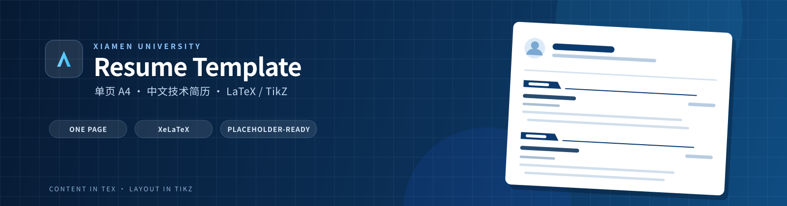
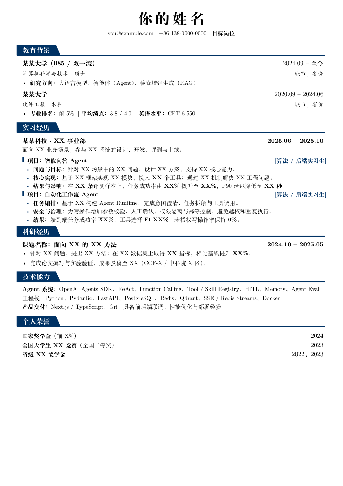

<div align="center">



**面向高校本科 / 研究生的单页 A4 中文技术简历模板**

AI Agent · 算法 · 后端开发 · 校招 / 实习

[](LICENSE)
[](#-快速开始)
[](#-适合谁)
[](#-xmu-主题)


[](https://github.com/LinYeeGiong/campus-tech-resume/generate)
[](https://www.overleaf.com/docs?snip_uri=https%3A%2F%2Fgithub.com%2FLinYeeGiong%2Fcampus-tech-resume%2Farchive%2Frefs%2Fheads%2Fmain.zip)
[](preview.pdf)

[模板预览](#-模板预览) · [适合谁](#-适合谁) · [岗位指南](CONTENT-GUIDE.md) · [快速开始](#-快速开始) · [自定义](#-自定义) · [仓库结构](#-仓库结构)

</div>

---

> 这份模板把版式留在 LaTeX，把内容集中到 `main.tex`：蓝梯形栏目、项目二级结构、Logo、证件照和个人主页都可以单独开关。

## 🖼️ 模板预览

当前预览使用 **XMU 主题**。非厦大同学可以直接替换 Logo，版式和项目结构不需要重做。

<p align="center">
  <a href="preview.pdf">
    
  </a>
</p>

<p align="center">
  <a href="preview.pdf"><b>查看完整 PDF →</b></a>
</p>

## 🎯 适合谁

面向准备校招、暑期实习和日常实习的本科生、硕士生与博士生，重点服务以下技术方向：

| 方向 | 项目里应该突出什么 | 内容建议 |
| --- | --- | --- |
| AI Agent / LLM 应用 | 任务编排、工具调用、Memory、HITL、评测、安全与成本 | [Agent 要点](CONTENT-GUIDE.md#ai-agent--llm-应用) |
| 算法 / 机器学习 | 问题定义、数据、方法、指标、消融与论文状态 | [算法要点](CONTENT-GUIDE.md#算法--机器学习) |
| 后端 / 平台开发 | 系统边界、并发、缓存、一致性、延迟、可用性与部署 | [后端要点](CONTENT-GUIDE.md#后端--平台开发) |

除上述方向外，也适用于全栈开发、数据工程、系统开发等计算机相关岗位。完整写法见 [`CONTENT-GUIDE.md`](CONTENT-GUIDE.md)。

## ✨ 设计重点

<table>
<tr>
<td width="50%" valign="top">

### 🔷 高识别度标题

用 TikZ 绘制蓝色梯形栏目和延伸线。相比普通横线标题，信息层级更清楚，又不会牺牲技术简历的克制感。

</td>
<td width="50%" valign="top">

### 🧱 两层级项目排版

公司信息、项目名称、角色标签和技术要点各有固定层级。适合 Agent、算法、后端等需要同时展示机制与结果的岗位。

</td>
</tr>
<tr>
<td valign="top">

### 🧩 校招内容结构

已包含教育背景、实习经历、科研经历、技术能力、个人荣誉五个常用模块，命令化组织，复制即可扩展。

</td>
<td valign="top">

### 🖼️ 完整的头部能力

左上角学校 Logo、右上角证件照或图片、目标岗位后的个人主页 / GitHub 链接均为独立可选配置。

</td>
</tr>
<tr>
<td valign="top">

### 📄 单页 A4

按 11pt、A4 和当前边距校准。项目符号、段间距和列表缩进经过压缩，适合一页承载两段实习和一段科研。

</td>
<td valign="top">

### 🌏 可移植编译

使用 XeLaTeX + `ctex` + Fandol 字体，不依赖本机中文字体。Overleaf 和本地 TeX Live 使用同一份源码。

</td>
</tr>
</table>

## 🚀 快速开始

### 方式一：直接使用模板

1. 点击仓库右上角 **Use this template**，或在 GitHub 创建新仓库。
2. 打开 `main.tex`，替换个人信息和经历。
3. 将编译器设置为 **XeLaTeX**，重新编译。

也可以直接点击：

[**Use this template**](https://github.com/LinYeeGiong/campus-tech-resume/generate) · [**Open in Overleaf**](https://www.overleaf.com/docs?snip_uri=https%3A%2F%2Fgithub.com%2FLinYeeGiong%2Fcampus-tech-resume%2Farchive%2Frefs%2Fheads%2Fmain.zip)

### 方式二：本地编译

```bash
git clone https://github.com/LinYeeGiong/campus-tech-resume.git
cd campus-tech-resume
make
```

也可以直接运行：

```bash
xelatex main.tex
xelatex main.tex
```

> 必须使用 **XeLaTeX**。`ctex` 和 `fontset=fandol` 已配置好，不要求系统安装宋体。

## 🎨 自定义

所有正文内容都集中在 [`main.tex`](main.tex)。按文件中的顺序替换以下占位内容：

- `你的姓名`、邮箱、电话、目标岗位
- `某某大学`、`某某科技`、`XX`、`XX\%`
- 教育、实习、科研、技能和荣誉条目

### 1. 个人主页 / GitHub

目标岗位后会显示个人链接。修改两个命令即可：

```latex
\newcommand{\resumeHomepageURL}{https://github.com/yourname}
\newcommand{\resumeHomepageLabel}{github.com/yourname}
```

使用个人网站时，把 URL 和显示文字换成自己的域名。

### 2. 学校 Logo / XMU 主题

模板默认使用 `xmu.png`，仓库同时保留 `xmu.svg` 矢量源文件：

```latex
\resumeLogo{xmu.png}
```

如不需要 Logo，注释掉这一行。替换学校或公司标识时，建议使用透明背景 PNG，宽度约为 `3.75cm`。

非厦大同学可以直接换成自己的学校标识；版式、栏目和项目结构都不需要修改。XMU 仅为视觉主题，不代表学校官方模板。

### 3. 右上角图片 / 证件照

把图片放到模板目录，然后取消 `main.tex` 中的注释：

```latex
\resumePhoto{photo.jpg}
```

默认宽度为 `2.35cm`，高度按原图比例缩放：

```latex
\newcommand{\resumePhotoWidth}{2.35cm}
```

支持 JPG、PNG 和 PDF。模板仓库不包含任何个人照片。

### 4. 主题颜色

```latex
\definecolor{MyDarkBlue}{RGB}{0,50,100}
```

学术深红可改为 `{139,0,0}`，纯黑可改为 `{0,0,0}`。修改后建议同步检查标题横线和正文的对比度。

<details>
<summary><b>🧩 命令速查</b></summary>

<br/>

| 命令 | 用途 |
| --- | --- |
| `\resumeEducationHeading{学校}{时间}{专业/学位}{城市}` | 教育背景 |
| `\resumeResearchHeading{机构/课题}{时间}` | 公司、科研或项目主标题 |
| `\resumeInternshipProjectHeading{项目名}{角色}` | 实习中的项目标题 |
| `\resumeInternshipItemListStart` / `End` | 项目下的二级要点 |
| `\resumeItem{...}` | 单个要点 |
| `\resumeProjectHeading{内容}{时间}` | 荣誉、奖项等单行条目 |
| `\resumeLogo{文件}` | 左上角 Logo |
| `\resumePhoto{文件}` | 右上角图片 |

</details>

## 🧱 仓库结构

```text
campus-tech-resume/
├── main.tex                 # 模板源码与全部可编辑内容
├── CONTENT-GUIDE.md         # AI Agent / 算法 / 后端内容写法
├── preview.pdf              # 编译后的单页示例（XMU 主题）
├── preview.png              # README 预览图
├── xmu.svg                  # 学校标识矢量源文件
├── xmu.png                  # LaTeX 引用的透明底标识
├── assets/
│   ├── banner.svg           # README 顶部横幅
│   └── social-preview.png   # GitHub 社交预览图
├── Makefile                 # 本地一键编译
├── LICENSE                  # MIT License
└── NOTICE.md                # 原始模板来源与改动说明
```

## 🧭 排版约定

- 栏目标题使用四个中文字符校准了梯形与横线的连接位置。改成英文或不同字数时，需要同步调整 `\titleformat{\section}` 中的 `xshift=-68.30pt`。
- 单页内容不足时，优先增加有信息量的项目或结果；不要用大段留白撑页面。
- 内容超出一页时，先删除重复背景和空泛形容词，再考虑调整 `\titlespacing`。
- 简历中的指标必须可解释、可复核。模板里的 `XX\%` 只表示占位，不应原样提交。

## ⚠️ 使用提醒

本模板只负责排版，不替代内容判断。请确保所有经历、数字和论文状态真实可核验；公开仓库中的示例内容均为占位文本。

XMU 主题为个人学习与开源分享用途，不代表厦门大学官方模板或官方背书。

## 📄 License

[MIT](LICENSE) © RenxuLogan

模板基于 [RenxuLogan/Modern-Resume](https://github.com/RenxuLogan/Modern-Resume)，当前版本在此之上增加了实习项目二级结构、可选 Logo / 证件照 / 个人主页等改动。详见 [NOTICE.md](NOTICE.md)。

<div align="center">
<br/>
<sub>如果这份模板帮你省下了一个下午，欢迎点个 ⭐</sub>
</div>
